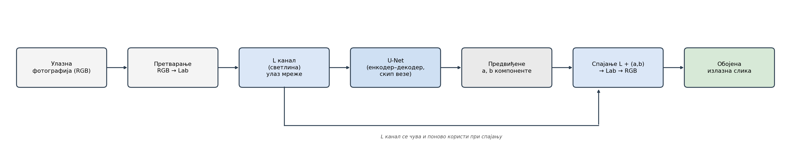
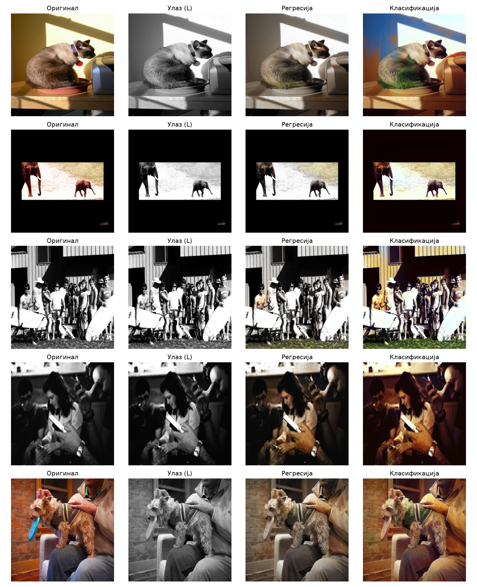
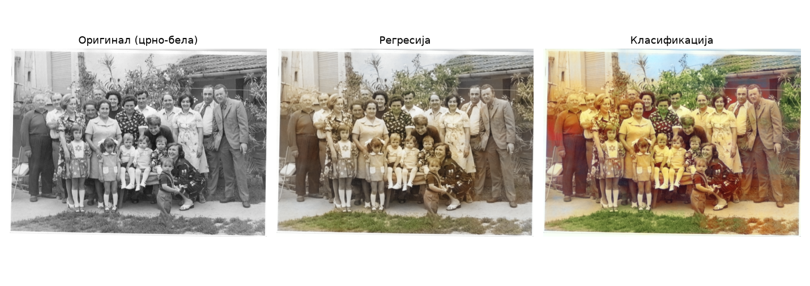
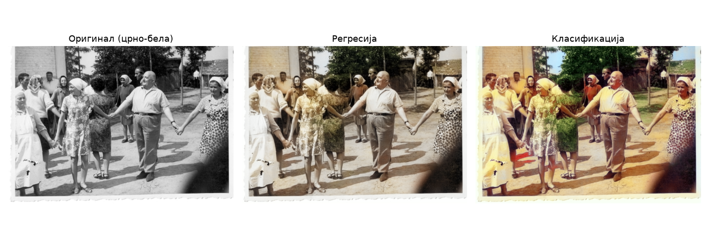

# Automatic Colorization of Black-and-White Photographs

Bachelor's thesis project, Faculty of Technical Sciences, University of Novi Sad (Computer Graphics Engineering, 2026).

A U-Net receives only the lightness channel **L** of an image in CIELAB color space and predicts the two color channels **a** and **b**. Two formulations of the task are compared as a controlled experiment, with identical architecture, data, split and training procedure. Only the output layer and the loss function change.



## Approaches

**Regression (baseline).** The network predicts ab values directly (2 output channels, tanh) and is trained with L1 loss. Because color is ambiguous, this averages plausible colors and tends to give pale results.

**Classification.** Following Zhang et al. (2016), the ab plane is quantized into a 22 × 22 grid of 484 bins (range −110 to 110, step 10). The network outputs a probability distribution over bins for every pixel and is trained with cross-entropy, weighted so that rare saturated colors are not ignored. The final color is decoded as an annealed mean with temperature T = 0.38, which gives smoother transitions than picking the most likely bin.

Both models are a 4-level U-Net with skip connections (about 7.7M parameters for the regression variant).

## Results

Averaged over 500 COCO validation images the models never saw during training. The grayscale baseline (ab = 0) is included as a control.

| Method | PSNR (dB) ↑ | SSIM ↑ | Colorfulness |
|---|---|---|---|
| Grayscale baseline | 24.34 | 0.9195 | 0.000 |
| Regression | 23.85 | 0.9220 | 0.090 |
| Classification | 20.77 | 0.8686 | 0.198 |
| Original images | – | – | 0.143 |

The main finding is that PSNR and SSIM reward caution rather than plausibility. The plain gray image beats both models on PSNR, and the ranking by colorfulness is exactly the reverse of the ranking by PSNR. Regression reaches about 63% of the original colorfulness (too pale), while classification reaches about 138% (oversaturated). The two approaches miss in opposite directions.



### Archival photographs

The models were also applied to scanned archival family photographs, where no ground-truth color exists, to judge plausibility and behavior outside the training domain. Each row shows the original black-and-white photo, the regression result and the classification result.





## Dataset

[COCO 2017](https://cocodataset.org/#download), chosen because it contains people in everyday indoor and outdoor scenes, similar to family photographs. A subset of 40,000 images from `train2017` is used, split 90/10 into training and validation with a fixed seed (42). Images are resized to 256 × 256. Place `train2017/` and `val2017/` in the project root.

## Training

12 epochs, Adam, learning rate 2·10⁻⁴, batch size 16 (regression) and 12 (classification), mixed precision. The checkpoint with the lowest validation loss is kept. Trained on an NVIDIA GeForce RTX 3050 (8 GB).

## How to run

```bash
pip install -r requirements.txt

python tezine_klasa.py          # class weights -> tezine_klasa.npy (already included)
python train.py                 # regression model
python train_klasifikacija.py   # classification model
python evaluacija.py            # PSNR, SSIM, colorfulness -> rezultati_eval/metrike.csv
python analiza_metrika.py       # metric distributions, colorfulness vs PSNR
python analiza_dodatna.py       # active color bins, difference from the gray baseline
```

To colorize your own black-and-white photos, put them in a folder named `porodicne_crnobele_slike/` and run `python porodicne_slike_test.py`.

Trained weights are saved to `checkpoints/` and are not included in this repository.

## Files

| File | Purpose |
|---|---|
| `dataset.py`, `dataset_klasifikacija.py` | Load images, convert RGB to Lab, build inputs and targets |
| `kvantizacija.py` | Quantization of the ab plane into 484 bins and back |
| `tezine_klasa.py` | Class weights for rare colors |
| `model.py`, `model_klasifikacija.py` | Regression and classification U-Net |
| `train.py`, `train_klasifikacija.py`, `train_oba.py` | Training (`train_oba.py` runs both) |
| `evaluacija.py`, `analiza_metrika.py`, `analiza_dodatna.py` | Quantitative evaluation and analysis |
| `dekodiranje_test.py` | Most likely bin vs annealed mean decoding |
| `porodicne_slike_test.py`, `porodicne_poredjenje_3col.py` | Colorization of archival photographs |
| `Lab_Test.py`, `pipeline_dijagram_v2.py`, `kriva_gubitka_kombinovano.py` | Figures for the thesis |

Code comments and variable names are in Serbian.

## References

R. Zhang, P. Isola, A. A. Efros. *Colorful Image Colorization.* ECCV 2016.
O. Ronneberger, P. Fischer, T. Brox. *U-Net. Convolutional Networks for Biomedical Image Segmentation.* MICCAI 2015.
D. Hasler, S. Süsstrunk. *Measuring Colourfulness in Natural Images.* SPIE 2003.
